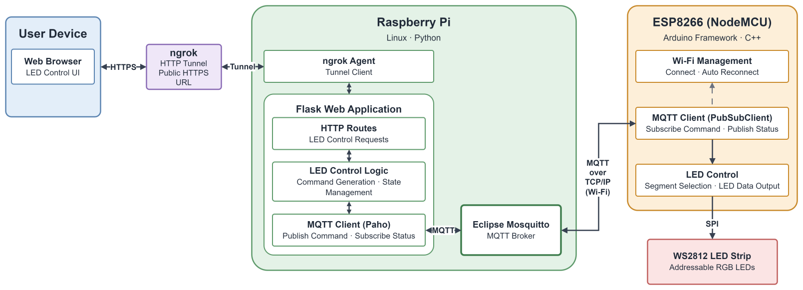

## Overview

**Remote LED Control System**

원격에서 물품의 위치를 LED로 안내하는 시스템입니다.

기존에는 물품의 위치를 전화로 설명하는 과정에서 위치 전달이 부정확하거나 반복적인 안내가 필요한 문제가 있었습니다.

이를 해결하기 위해 사용자가 웹에서 물품의 위치를 선택하면 해당 위치의 LED가 점등되도록 시스템을 구현했습니다.

**Key Features**
- 웹 인터페이스를 통한 위치별 LED ON/OFF 제어
- MQTT 기반 Raspberry Pi–ESP8266 간 명령 전달
- Raspberry Pi의 LED 상태 관리
- ESP8266의 WS2812 LED 제어
- MQTT를 통한 장치 상태 정보 전달

## System Architecture



### Component Responsibilities

| 구성요소 | 역할 |
|---|---|
| Web Browser | 사용자 입력 및 LED 제어 요청 |
| Raspberry Pi | HTTP 요청 처리, 제어 명령 생성 및 상태 관리 |
| MQTT Broker (Eclipse Mosquitto) | MQTT 메시지 중개 |
| ESP8266 (NodeMCU) | MQTT 명령 수신 및 LED 출력 제어 |
| WS2812 LED Strip | 선택된 위치의 LED 점등 및 소등 |

## Key Implementation

### Core Features

| 핵심 구현 | 설명 | 관련 기술 |
|---|---|---|
| 웹 기반 LED 제어 | 사용자 요청을 수신하고 LED 제어 명령 생성 | Flask, Python |
| MQTT 통신 | 제어 명령 Publish 및 장치 상태 Subscribe | Paho MQTT, PubSubClient |
| LED 제어 | 수신 명령 해석 및 위치별 LED 제어 | Arduino Framework |

### MQTT Message Interface

Raspberry Pi와 ESP8266 간 제어 명령 전달을 위해 MQTT 메시지 형식을 정의했습니다.

**Command Topic**
```text
node/<Board_ID>/cmd
```

**Payload Format**
```text
<seg>,<state>
```

**Example**
```text
2,ON
```

- `Board_ID`: 명령을 수신할 ESP8266의 장치 식별자
- `seg`: 제어 대상 LED 세그먼트 번호
- `state`: LED 제어 상태 (`ON` / `OFF`)

## Demo Video

[](https://youtu.be/b72nmJlugdU)
